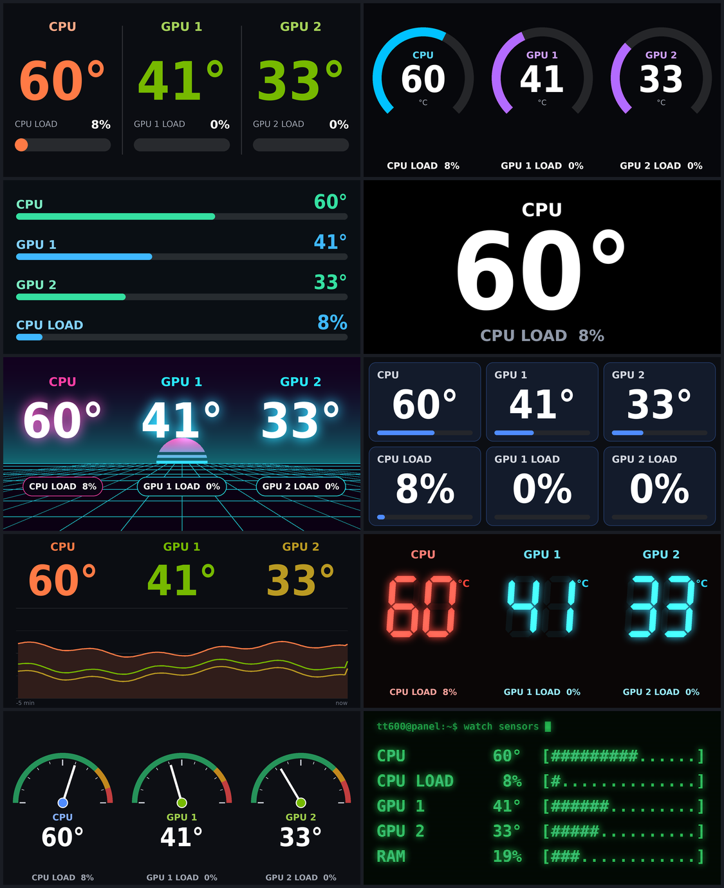
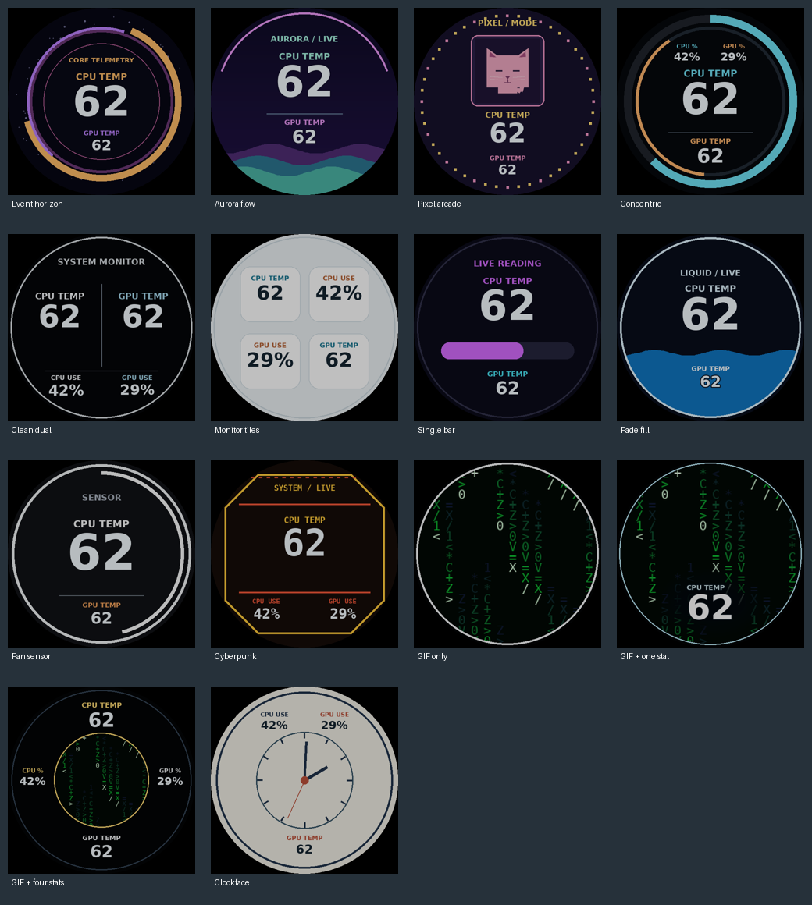
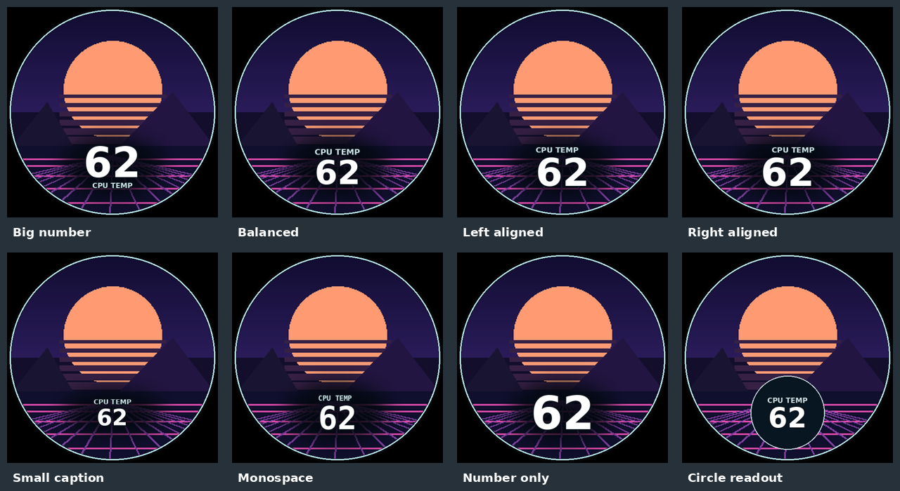
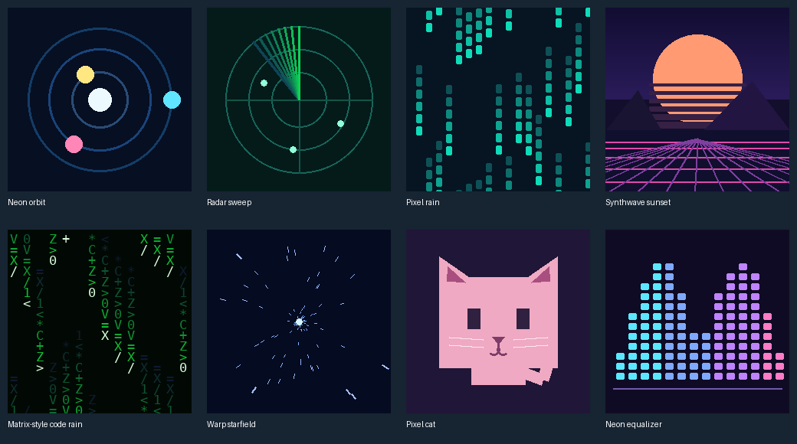

# Thermaltake View 600 TG 6" LCD screen on Linux

Use the **Thermaltake 6.0" LCD Panel Kit for View 600 TG** on Linux: a system
monitor dashboard for the case screen, with no Windows and no TT RGB Plus.

Thermaltake only supports this panel on Windows. This project drives it
directly over USB and shows your CPU and GPU temperatures in big, readable
layouts, so you can read them from across the room.



## Supported hardware

| | |
|---|---|
| Product | Thermaltake 6.0" LCD Panel Kit for View 600 TG |
| Part number | `AC-080-OO1NAN-A1` |
| USB ID | `264a:2347` (`lsusb` shows "ThermalTake USB Device") |

The ID-COOLING SL360 XE pump LCD is an optional second display. Its controls
appear only when the `CT21INCH` USB serial device is connected. The two
displays have separate services and saved settings.

Check that yours is connected: `lsusb | grep 264a:2347`

Other Thermaltake screens (Tower 200/500 bar, RC Pro, TH420 and AIO displays)
use a different protocol. See the
[projects listed here](docs/PROTOCOL.md#why-not-the-existing-thermaltake-linux-tools).

## Features

- **10 templates**: big numbers, ring gauges, bars, tiles, speedometer, digital
  7-segment, history graph, terminal, synthwave, single metric
- **Multi-GPU**: each NVIDIA card gets its own reading
- **Any sensor**: CPU, GPU, RAM, SSD and fans, any `hwmon` sensor, or any
  command that prints a number
- **Tray app** with a live-preview settings window: templates, colours,
  labels, background image, font, brightness
- **Starts at boot**, and uses about 0.2% of one CPU core and ~35 MB of memory
- **Your own templates**: drop a Python file in a folder
- **Optional pump LCD**: fourteen circular 480×480 designs, live stats,
  rotations, eight original GIF loops, and custom GIFs

## Install

Tested on Ubuntu 26.04 (GNOME). Needs Python 3. The installer pulls in Pillow,
psutil, pyserial, and GTK/AppIndicator for the tray.

```sh
git clone https://github.com/deniswsrosa/thermaltake-6inch-lcd-linux.git
cd thermaltake-6inch-lcd-linux
./install.sh
```

The installer asks for `sudo` once, to install a udev rule so the panel can be
used without root. It then:

- starts the `tt600d` service, which runs from boot, even before you log in
- starts the optional `tt600-pumpd` service, which waits for the pump when absent
- adds a **Thermaltake LCD** tray icon that starts when you log in

## Use

Click the **tray icon** to switch template, °C/°F or brightness, or open
**Customize…** to change what each slot shows, colours, labels and more,
with a live preview. Changes show on the panel right away.

More in [docs/CUSTOMIZING.md](docs/CUSTOMIZING.md): custom sensors and
commands, background images, fonts, writing your own template, and the
command-line tools.

### Configure the optional pump LCD



When the pump is detected, open **Customize… → Pump LCD** or
**Configure pump LCD…** from the tray menu. The preview shows live readings;
**Save and apply** sends the design to the pump service. Run
`python3 pump_mock.py` for a standalone preview without opening the USB device.
Its **Save draft** writes a separate preview file and never changes the live
pump profile.
The eight bundled GIFs include Matrix-style code rain,
starfield, a pixel cat, an equalizer, orbit, radar, pixel rain, and synthwave.
They are original artwork; **My GIF** lets you preview another GIF from your
computer. The screen modes follow common choices documented by
[NZXT](https://support.nzxt.com/hc/en-us/articles/47990263478683-What-display-modes-are-available-for-my-Kraken-cooler),
[Lian Li](https://lian-li.com/product/galahad-ii-lcd/), and
[Corsair](https://help.corsair.com/hc/en-us/articles/4412131516813-ELITE-LCD-How-to-set-up-your-ELITE-LCD-in-iCUE-4-or-newer).
The mock includes an animated Event horizon, Aurora flow, Pixel arcade, a
centered clockface, plus gauges and monitor layouts. The artwork and layout
details are original rather than copied brand assets. Clicking a GIF preset
starts in **GIF only** mode. The GIF tab also offers **GIF + one stat**, with
eight readout layouts and five positions, or **GIF + four stats**, which places
the animation in the center and readings around it. The preview crops to the
physical circle and keeps labels within its safe area.



The [pump integration notes](docs/PUMP_INTEGRATION.md) describe device
detection, the separate pump service, rotation, and transport licensing.



## Troubleshooting

| Problem | Fix |
|---|---|
| Nothing on the panel | `systemctl --user status tt600d` and `journalctl --user -u tt600d -f` |
| "Panel not found" in the tray | check `lsusb \| grep 264a:2347`; re-run `./install.sh` (udev rule); log out and in if you were just added to `plugdev` |
| No tray icon on GNOME | enable the AppIndicator extension (`gnome-extensions enable ubuntu-appindicators@ubuntu.com` on Ubuntu) |
| GPU shows `--` | only NVIDIA cards are read directly; for AMD, pick the `amdgpu` sensor in the metric list |
| Pump page appears but LCD does not update | Check `systemctl --user status tt600-pumpd` and `journalctl --user -u tt600-pumpd -n 30`; if the pump firmware will not wake, fully shut down and remove PSU power briefly before starting again. |

## Uninstall

```sh
./uninstall.sh
```

## How it works

The panel runs embedded Linux and speaks an HTTP-like protocol over USB HID,
recovered from TT RGB Plus. The details are in [docs/PROTOCOL.md](docs/PROTOCOL.md).

## License

MIT. Not affiliated with or endorsed by Thermaltake.
